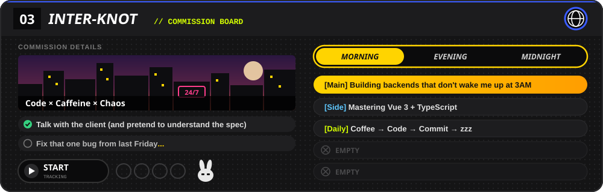

<div align="center">



<a href="https://github.com/blueberryoghurt">
  
</a>

<p>
  
  <a href="https://github.com/blueberryoghurt?tab=followers"></a>
  
</p>


## ◢ AGENT FILE



</div>

```yaml
agent:      BLUYO
role:       Software Engineer
faction:    Blueberry Heavy Industry
attribute:  Electric ⚡
specialty:  Backend / API craftsmanship
location:   Sixth Street, New Eridu
status:     Taking commissions — open to collabs
```

<div align="center">


## ◢ W-ENGINES <sub><sup>// equipped tech</sup></sub>


<br/><br/>


## ◢ INTER-KNOT




## ◢ PROXY RECORDS




<sub>Fan-made theme inspired by <i>Zenless Zone Zero</i>. Not affiliated with HoYoverse.</sub>

</div>
